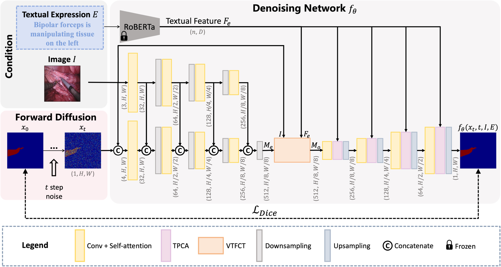

# TPDPM-Text-promptable-diffusion-probabilistic-model-for-referring-surgical-instrument-segmentation
# Introduction
Hi, this is the code repository for " TPDPM:: Text promptable diffusion probabilistic model for referring surgical instrument segmentation" (Accepted by Computerized Medical Imaging and Graphics) in PyTorch.



In this paper, we propose a novel Text Promptable Diffusion Probabilistic Model (TPDPM) for referring surgical instrument segmentation (RSIS). Specifically, our model takes both surgical images and referring textual expressions as input. Instead of directly predicting segmentation masks via discriminative pixel-wise classification as existing RSIS methods do, we formulate RSIS as a conditional mask generation task rooted in diffusion probabilistic models: starting from a noisy mask, the target instrument mask is gradually refined through the reverse diffusion process conditioned on visual and language inputs. Benefiting from the inherent stochastic sampling of diffusion models, we ensemble multiple sampled predictions to handle ambiguous instrument boundaries, which supports both accurate segmentation and reliable uncertainty assessment. Then, we thoroughly validate TPDPM on two public porcine surgical video datasets, EndoVis-RS17 and EndoVis-RS18, as well as one in-house patient video dataset. At the inference stage, TPDPM generates the mask of the referred instrument given only a surgical image and a referring text prompt.

# Citation
If you are interested in this work, please cite the following work:
```bibtex
@article{GUAN2026102770,
title = {TPDPM: Text promptable diffusion probabilistic model for referring surgical instrument segmentation},
journal = {Computerized Medical Imaging and Graphics},
volume = {131},
pages = {102770},
year = {2026},
issn = {0895-6111},
doi = {https://doi.org/10.1016/j.compmedimag.2026.102770},
url = {https://www.sciencedirect.com/science/article/pii/S089561112600073X},
author = {Jiale Guan and Xiaoyang Zou and Simeng Luo and Guoyan Zheng},
}
